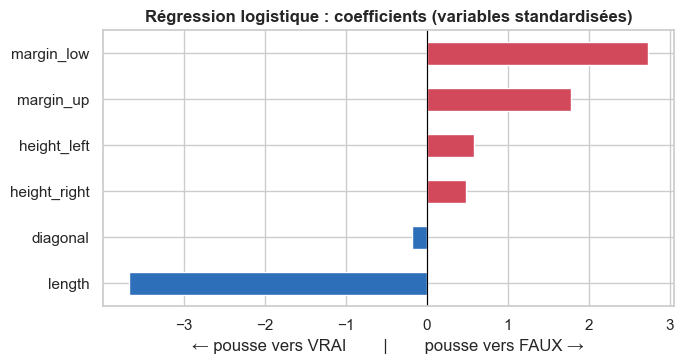

# 09 · Détection automatique de faux billets

**Contexte.** L'ONCFM (organisme fictif de lutte contre le faux-monnayage) dispose d'une machine qui mesure 6 dimensions de chaque billet. Il veut une application qui dise « vrai » ou « faux ».

**Ma mission.** Comparer 4 méthodes, choisir la plus adaptée et livrer une application utilisable.

**Outils.** Python, scikit-learn, statsmodels, joblib.

## Démarche

1. **Contrôle qualité** : 1 500 billets, 37 valeurs manquantes sur une seule mesure, aucun doublon.
2. **Imputation par régression** plutôt que par la moyenne (erreur réduite de 28 % en validation croisée), intégrée au pipeline pour fonctionner aussi en production.
3. **Protocole honnête** : découpage stratifié 75/25, réglage par validation croisée sur le seul jeu d'entraînement, évaluation finale unique.
4. **4 modèles** : régression logistique, KNN, Random Forest, k-means.

## Résultats sur le jeu de test (375 billets, dont 125 faux)

| Modèle | Faux détectés | Fausses alertes |
|---|---|---|
| Régression logistique | 121 / 125 | 0 |
| KNN (k = 3) | 121 / 125 | 0 |
| Random Forest | 120 / 125 | 1 |
| K-means | 121 / 125 | 1 |

**Modèle retenu : la régression logistique.** Elle est au meilleur niveau, explicable (ses coefficients disent pourquoi un billet est jugé faux) et donne une vraie probabilité par billet.

## Fichiers

- [notebook_analyse.ipynb](notebook_analyse.ipynb) : l'analyse complète.
- [application_detection.py](application_detection.py) : l'application. Exemple : `python application_detection.py billets_production.csv`
- [modele_faux_billets.joblib](modele_faux_billets.joblib) : le modèle entraîné.
- [presentation.pdf](presentation.pdf) : la restitution.
