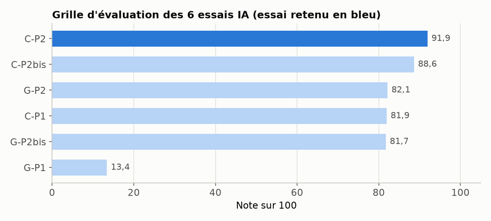
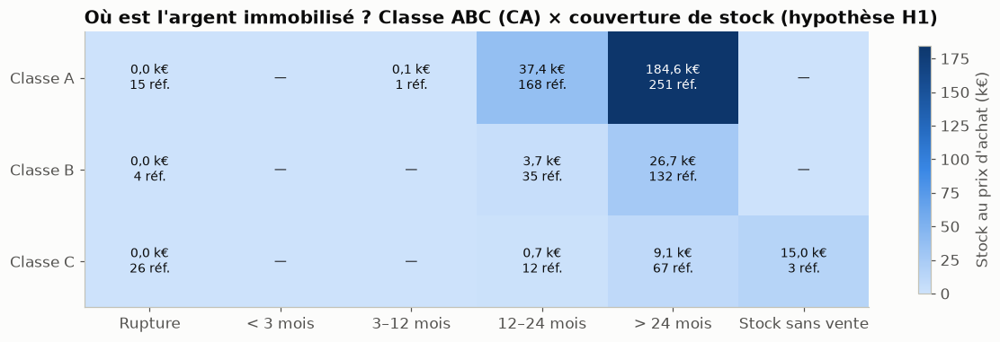

# BottleNeck amélioré avec l'IA : contrôles qualité et analyse critique

**Contexte.** Projet de fin de parcours : reprendre le [projet BottleNeck d'origine](../bottleneck_analyse_stocks/) en utilisant l'IA de façon critique et documentée.

**Ma mission.** Comparer deux IA sur un protocole mesuré, en retenir le meilleur code, l'intégrer à un notebook amélioré, et documenter toute la démarche (veille, cahier des charges, gestion de projet, formation, limites).

**Outils.** Python, pandas, Pandera, Great Expectations, Claude, Gemini, Airtable (Kanban), Word.

## Le test des IA

- **Protocole fixé à l'avance** : 2 prompts, 6 essais, Claude contre Gemini, aucune donnée réelle transmise aux IA.
- **Banc de test automatique** : chaque code produit est exécuté sur un référentiel de 10 anomalies connues ; reproductibilité mesurée entre essais.
- **Grille sur 100** : qualité, biais, temps, reproductibilité, sécurité, conformité.
- Meilleur essai : 91,9 / 100 (Claude). Un essai Gemini a échoué à l'exécution : il appelait une fonction qui n'existe pas dans Pandera.
- Comparaison mesurée de 3 façons de contrôler les données (pandas seul, Pandera, Great Expectations) : les trois détectent les 10 anomalies (Pandera au deuxième essai, après correction d'un réglage par défaut qui ignorait les valeurs vides), avec des écarts nets de poids et de complexité.

## Le notebook amélioré

- **64 règles de contrôle**, dont 3 ajoutées et justifiées ; **325 anomalies** détectées sur les fichiers bruts (197 bloquantes, 128 alertes), avec un rapport Excel.
- Nettoyage piloté par les règles, avec un journal des décisions.
- Jointure vérifiée par assertions : 714 produits.
- Stocks analysés sous deux hypothèses explicites de période de vente, stocks dormants chiffrés, matrice ABC × couverture.
- Corrélation de Spearman en plus de Pearson : le lien stock-ventes passe de 0,44 à 0,76.
- Tests de non-régression : le notebook s'arrête si un chiffre du comité de direction change.

## Fichiers

- [notebook_ameliore.ipynb](notebook_ameliore.ipynb) : le notebook, avec ses résultats.
- [controles_qualite.py](controles_qualite.py) : le module des 64 règles.
- [rapport_qualite_donnees.xlsx](rapport_qualite_donnees.xlsx) : le rapport des anomalies.
- [documentation_demarche.pdf](documentation_demarche.pdf) : veille, cahier des charges, gestion de projet, essais, formation, limites et décisions.
- [essais_IA/](essais_IA/) : réponses brutes des IA, codes, résultats et banc de test.
- [LISEZMOI_execution.md](LISEZMOI_execution.md) et [requirements.txt](requirements.txt) : pour relancer le notebook.

*Données fournies par OpenClassrooms, entreprise fictive ; non redistribuées ici. Pour relancer le notebook, placer `erp.xlsx`, `web.xlsx` et `liaison.xlsx` dans le dossier.*
