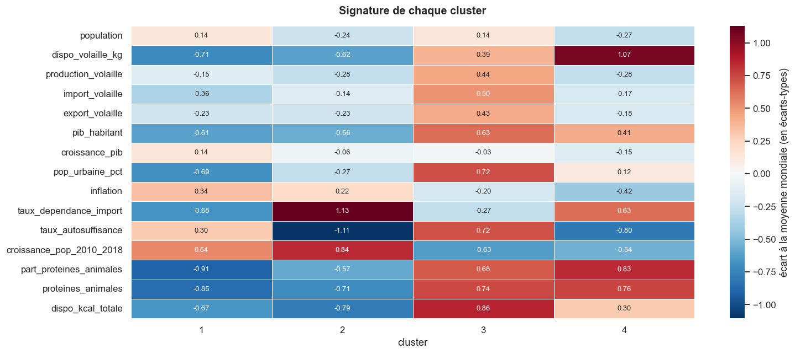

# Export international : où vendre des poulets bio ?

**Contexte.** La Poule qui chante (entreprise fictive) veut exporter ses poulets bio et cherche des groupes de pays cibles, avec une méthode qu'elle pourra relancer dans deux ans.

**Ma mission.** Construire un jeu de données pays, le segmenter, puis recommander des marchés.

**Outils.** Python, pandas, scikit-learn, SciPy ; grille PESTEL.

## Démarche

1. **Données** : 3 sources (bilans alimentaires et population de la FAO, indicateurs de la Banque mondiale) assemblées en un tableau d'un pays par ligne : 164 pays, 96,3 % de la population mondiale, aucune valeur manquante.
2. **Variables** choisies avec la grille PESTEL, dont 4 créées : dépendance aux importations, autosuffisance, croissance démographique, part de protéines animales.
3. **ACP** : 4 axes retenus (75,2 % de l'information).
4. **Classification** hiérarchique et k-means : 4 groupes ; les deux méthodes classent 82,9 % des pays de la même façon.
5. **Filtres commerciaux** (pouvoir d'achat, dépendance aux importations, taille, plateformes de réexport) puis score pondéré.

## Recommandation

Le Koweït et l'Arabie saoudite (pays riches, gros consommateurs, dépendants des importations) et l'Irlande (marché européen proche, sans barrière douanière).

## Fichiers

- [1_preparation_exploration.ipynb](1_preparation_exploration.ipynb) : assemblage, nettoyage, exploration.
- [2_clustering.ipynb](2_clustering.ipynb) : ACP, classification, score des marchés.
- [presentation.pdf](presentation.pdf) : la restitution au comité de direction.

*Données open data (FAO, Banque mondiale) ; non redistribuées ici.*
