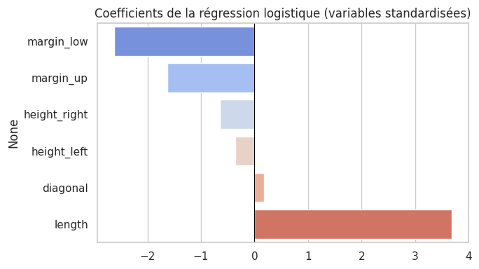

# Détection automatique de faux billets

**Contexte.** L'ONCFM (organisme fictif de lutte contre le faux-monnayage) dispose d'une machine qui mesure 6 dimensions de chaque billet. Il veut une application qui dise « vrai » ou « faux ».

**Ma mission.** Comparer 4 méthodes, choisir la plus adaptée et livrer une application utilisable.

**Outils.** Python, scikit-learn, joblib, Streamlit.

## Démarche

1. **Contrôle qualité** : 1 500 billets (1 000 vrais, 500 faux), aucun doublon, 37 valeurs manquantes sur la marge basse.
2. **Imputation par régression linéaire** à partir des 5 autres mesures, sans utiliser l'étiquette vrai/faux, inconnue en production.
3. **Découpage stratifié** 80/20 (1 200 billets d'apprentissage, 300 de test), standardisation, réglage par validation croisée.
4. **4 modèles** : k-means (non supervisé), régression logistique, KNN, Random Forest.

## Résultats

Sur le jeu de test (300 billets, dont 100 faux), les 4 modèles dépassent 98 % de bonnes réponses : l'écart n'est que de 2 à 3 erreurs. Ils ont donc été départagés par une validation croisée à 10 plis :

| Modèle | Exactitude | Faux billets détectés |
|---|---|---|
| Régression logistique | 99,13 % | 98,2 % |
| Random Forest | 99,13 % | 98,0 % |
| KNN (k = 12) | 99,00 % | 97,8 % |

**Modèle retenu : la régression logistique.** Elle est au meilleur niveau, explicable (la longueur et la marge basse pèsent le plus), donne une vraie probabilité par billet et reste simple à maintenir.

## Fichiers

- [notebook_analyse.ipynb](notebook_analyse.ipynb) : l'analyse complète.
- [application/](application/) : l'application de prédiction. Exemple : `python predict_billets.py --csv billets_production.csv` ; interface de démonstration : `streamlit run app_streamlit.py`.
- [presentation.pptx](presentation.pptx) : la restitution.
