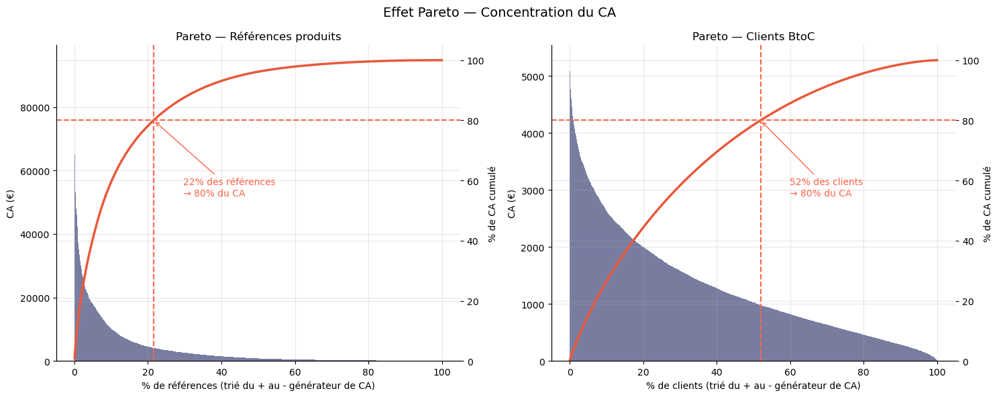

# Lapage : analyse des ventes d'une librairie en ligne

**Contexte.** Lapage (librairie fictive) veut comprendre son activité en ligne de mars 2021 à février 2023 et le comportement de ses clients.

**Ma mission.** Nettoyer les transactions, produire les indicateurs clés et tester statistiquement les liens entre profil client et achats.

**Outils.** Python, pandas, SciPy, matplotlib, seaborn.

## Démarche et résultats

- **Nettoyage tracé** : 200 lignes de test supprimées, 827 doublons retirés, une référence hors catalogue imputée au prix médian de sa catégorie, un trou de données en octobre 2021 imputé par régression.
- **Indicateurs** : environ 11,8 M€ de CA sur deux ans, 8 600 clients actifs, 3 265 références vendues, panier moyen de 34,63 €.
- **Concentration** : 21,5 % des références font 80 % du CA ; indice de Gini de 0,40 chez les clients particuliers.
- **4 clients professionnels** identifiés, qui pèsent 7,4 % du CA sans offre dédiée.
- **Tests statistiques** : pas de lien entre genre et catégorie achetée (khi-deux, p = 0,138) ; liens significatifs mais modérés entre l'âge et le montant, la fréquence et le panier (Spearman) ; choix de Kruskal-Wallis plutôt que l'ANOVA après vérification des conditions.

## Fichiers

- [notebook_lapage.ipynb](notebook_lapage.ipynb) : l'analyse complète.
- [presentation.pdf](presentation.pdf) : la restitution à l'équipe marketing.

*Données fournies par OpenClassrooms, entreprise et clients fictifs ; non redistribuées ici.*
