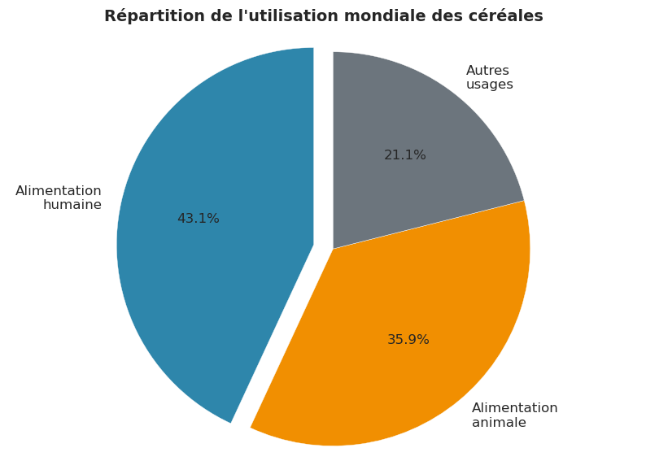

# Étude de santé publique : la sous-nutrition dans le monde (FAO)

**Contexte.** La FAO veut une vue d'ensemble de la sécurité alimentaire mondiale entre 2013 et 2017 : qui manque de nourriture, et pourquoi, alors que la production mondiale suffit.

**Ma mission.** Préparer et croiser quatre jeux de données de la FAO, construire les indicateurs et présenter les résultats.

**Outils.** Python, pandas, matplotlib, seaborn, Jupyter.

## Démarche

1. **Préparation** : 4 sources (disponibilité alimentaire 2017, sous-nutrition, population, aide alimentaire 2013-2016), unités harmonisées, valeurs manquantes traitées, jointures par pays.
2. **Indicateurs** : apports en kilocalories par personne et par jour, capacité théorique à nourrir la population (sur une base de 2 250 kcal par jour), usages des céréales.
3. **Classements** : pays les plus touchés par la sous-nutrition, principaux bénéficiaires de l'aide, évolution de l'aide.

## Résultats

- **535,7 millions de personnes sous-alimentées en 2017**, soit 7,1 % des 7,55 milliards d'habitants.
- **Le monde produit assez** : la disponibilité alimentaire permettrait de nourrir 9,3 milliards de personnes, 1,23 fois la population ; les seuls végétaux en nourriraient 7,67 milliards. Le problème est la répartition, pas la quantité.
- **Céréales** : 43 % vont à l'alimentation humaine, 36 % à l'alimentation animale.
- **Aide alimentaire 2013-2016** : la Syrie, l'Éthiopie et le Yémen en reçoivent 40 % à eux trois.

## Fichiers

- [notebook_FAO.ipynb](notebook_FAO.ipynb) : l'analyse complète.
- [presentation.pdf](presentation.pdf) : la restitution.

*Données de la FAO fournies par OpenClassrooms ; non redistribuées ici.*
